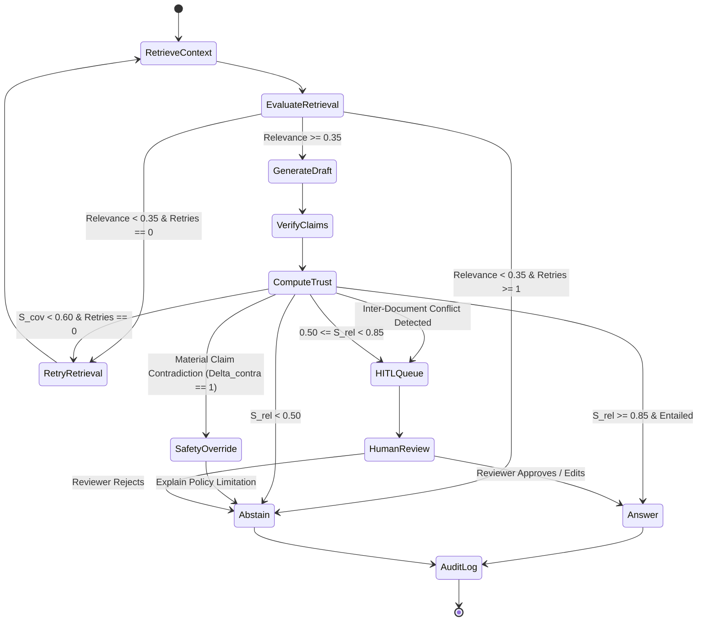
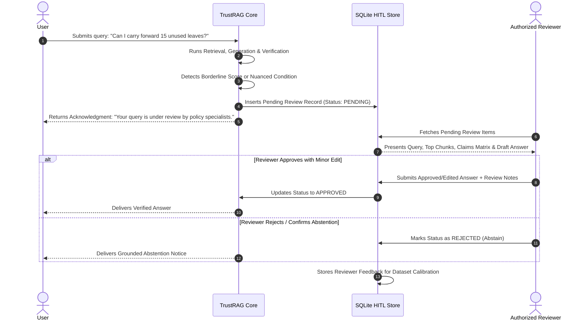

# Decision Engine & Human-in-the-Loop Workflow

## 1. Overview

The **Decision Engine** is the orchestration nucleus of TrustRAG. Built on **LangGraph**, it executes a stateful directed acyclic and cyclic workflow that analyzes the outputs of the Retrieval, Generation, and Verification engines to determine the safest, most transparent action.

Rather than blindly returning an answer, the Decision Engine has 5 distinct execution paths:
1. **`ANSWER`**: High reliability; return answer with explicit document citations.
2. **`RETRY`**: Partial evidence coverage; reformulate query and re-execute retrieval (capped at 1 retry).
3. **`CLARIFY`**: Query is ambiguous or underspecified; request user clarification.
4. **`ABSTAIN`**: Evidence is insufficient or claims contradict policy; return responsible, grounded refusal.
5. **`ESCALATE`**: Borderline trust or sensitive domain query; route to Human-in-the-Loop (HITL) review queue.

---

## 2. State Machine Flowchart



---

## 3. Decision Logic & Routing Policies

### 3.1 Policy 1: Immediate Safety Circuit Breaker
```python
if verification_matrix.has_contradiction:
    # A contradiction exists between draft claims and evidence
    return Action.ABSTAIN(
        reason="CONTRADICTION_DETECTED",
        explanation="The requested scenario is refuted or unpermitted by the verified policy documents.",
        safe_response=generate_responsible_refusal(query, evidence)
    )
```

### 3.2 Policy 2: High Confidence Grounded Answer
```python
if trust_score >= 0.85 and verification_matrix.unsupported_claims_count == 0:
    return Action.ANSWER(
        answer_text=draft_answer.text,
        citations=draft_answer.citations,
        trust_score=trust_score,
        claims_breakdown=verification_matrix.claims
    )
```

### 3.3 Policy 3: Low Coverage / Retrieval Retry Loop
```python
if coverage_score < 0.60 and retry_count < 1:
    retry_query = reformulate_query_for_missing_facets(query, missing_facets)
    return Action.RETRY(new_query=retry_query, retry_count=retry_count + 1)
```
*Note: Retries are strictly capped at 1 to prevent infinite graph execution loops and minimize API latency.*

### 3.4 Policy 4: Grounded Abstention
```python
if trust_score < 0.50 or retrieval_max_score < 0.35:
    return Action.ABSTAIN(
        reason="INSUFFICIENT_EVIDENCE",
        explanation="The provided corporate documents do not contain sufficient evidence to answer this query factually."
    )
```

### 3.5 Policy 5: Human-in-the-Loop Escalation (Borderline Confidence)
```python
if 0.50 <= trust_score < 0.85:
    return Action.ESCALATE(
        reason="BORDERLINE_TRUST",
        queue_target="HITL_REVIEW_QUEUE"
    )
```

### 3.6 Policy 6: Inter-Document Policy Conflict Escalation
```python
if verification_matrix.inter_document_conflict_detected:
    # Conflicting policies exist in retrieved corpus (e.g. 2023 policy vs 2026 addendum)
    # The system must not assume the answer is false or guess which policy takes precedence
    return Action.ESCALATE(
        reason="INTER_DOCUMENT_POLICY_CONFLICT",
        queue_target="HITL_REVIEW_QUEUE",
        conflicting_sources=verification_matrix.conflicting_chunk_ids
    )
```

---

## 4. Human-in-the-Loop (HITL) Workflow

When an answer is escalated to HITL:



---

## 5. Reviewer Dashboard Interface Specifications

The Human Reviewer inspects a comprehensive side-by-side terminal or UI panel containing:
1. **Query & Intended Meaning**: User query with extracted facet tags.
2. **Retrieved Evidence Passages**: Ranked passages with document names, exact page numbers, and highlighted keywords.
3. **Draft Answer & Claim Annotations**:
   - Green highlights for strictly entailed claims.
   - Yellow highlights for unsupported/neutral claims.
   - Red highlights for contradicted statements.
4. **Trust Score Telemetry**: Breakdown of $S_{\text{faith}}, S_{\text{cov}}, S_{\text{ret}}, S_{\text{prov}}$.
5. **Reviewer Actions**:
   - `Approve Draft`: Releases response to user as-is.
   - `Edit and Approve`: Allows reviewer to edit the text and assign citations before delivery.
   - `Reject & Abstain`: Converts response into a formal document-grounded refusal.
   - `Flag for Dataset`: Exports the item to the golden evaluation dataset for model re-calibration.

