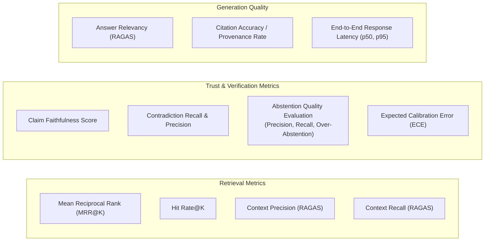

# Evaluation Framework & Benchmark Specification

## 1. Overview

A trust-aware RAG system cannot be evaluated solely on standard BLEU, ROUGE, or subjective "looks good" heuristics. TrustRAG requires a rigorous, multi-faceted benchmark that tests both **positive competencies** (correctly answering substantiated questions) and **negative safety competencies** (correctly refusing unanswerable questions, detecting contradictions, and flagging partial evidence).

---

## 2. Benchmark Query Topology & Ground-Truth Design

### 2.1 Mandatory Manual Verification Requirement
Every benchmark item in the evaluation suite must be **manually curated and verified by human domain auditors**. Automated synthetic QA generation alone is insufficient for trust benchmarking because synthetic pipelines often inherit the generator's biases.

Each benchmark record must explicitly include:
1. `query_id`: Unique identifier.
2. `query_text`: Natural language user question.
3. `category`: One of the 5 archetypes below.
4. `expected_action`: Target decision (`ANSWER`, `ABSTAIN`, `CLARIFY`, `ESCALATE`).
5. `gold_answer`: Manually verified expected textual response.
6. `gold_evidence_chunks`: Exact chunk IDs and verbatim text excerpts providing necessary proof.
7. `expected_claims`: Decomposed atomic facts with expected tripartite labels (`ENTAILMENT`, `CONTRADICTION`, `NEUTRAL`).

### 2.2 Concrete Benchmark Archetypes & Examples

#### Archetype 1: Answerable Query
- **User Query**: *"How many paid leaves do employees receive annually, and can I carry forward unused leaves?"*
- **Supporting Gold Evidence**:
  - `doc_a3f89b_p003_c0012`: *"Employees receive 18 paid leaves annually. Unused leaves can be carried forward up to a maximum of 5 days into the following calendar year."*
- **Gold Answer**: *"Employees receive 18 paid leaves annually [Page 3]. Unused leaves can be carried forward up to a maximum of 5 days into the next calendar year [Page 3]."*
- **Expected Action**: `ANSWER` ($S_{\text{rel}} \ge 0.85$, zero contradiction, 100% entailment).

#### Archetype 2: Unanswerable Query (Missing Domain Topic)
- **User Query**: *"What is the policy for parental paternity leave duration and pay?"*
- **Supporting Gold Evidence**: None (Topic completely absent from the indexed handbook).
- **Gold Answer**: *"The provided documents do not contain information regarding paternity leave duration or pay."*
- **Expected Action**: `ABSTAIN` (Retrieval $R_{\text{rerank}} < 0.35$, zero hallucinated claims).

#### Archetype 3: Contradictory Query (Exceeding Constraints)
- **User Query**: *"Can I carry forward 15 unused leaves into next year?"*
- **Supporting Gold Evidence**:
  - `doc_a3f89b_p003_c0012`: *"Unused leaves can be carried forward up to a maximum of 5 days into the following calendar year. Any remaining unused leave beyond 5 days will lapse automatically."*
- **Gold Answer**: *"According to the policy, employees can carry forward a maximum of 5 unused leaves. Carrying forward 15 unused leaves is not permitted [Page 3]."*
- **Expected Action**: `ABSTAIN` / Explain Limitation ($\Delta_{\text{contra}} = 1$ triggered if generator asserts 15 days is allowed).

#### Archetype 4: Ambiguous Query (Underspecified Premise)
- **User Query**: *"Can I work from home tomorrow without getting approval?"*
- **Supporting Gold Evidence**:
  - `doc_a3f89b_p003_c0012`: *"Work-from-home requires manager approval."*
- **Gold Answer**: *"Work-from-home requires manager approval in all cases. Working from home without approval is not supported by the policy."*
- **Expected Action**: `ANSWER` (if clarifying the negative condition) or `CLARIFY` / `ESCALATE` (if intent remains ambiguous).

#### Archetype 5: Partially Supported Query
- **User Query**: *"How many unused leaves can I carry forward, and can I encash the remaining balance for cash?"*
- **Supporting Gold Evidence**:
  - `doc_a3f89b_p003_c0012`: *"Unused leaves can be carried forward up to a maximum of 5 days into the following calendar year."* (Encashment is not mentioned anywhere in the corpus).
- **Gold Answer**: *"Employees can carry forward up to 5 unused leaves into the next year [Page 3]. However, the provided policy documents do not contain information regarding leave encashment."*
- **Expected Action**: `ANSWER` with explicit boundary labeling (part A verified, part B labeled unsupported) or `ESCALATE` to Human-in-the-Loop review.

---

## 3. Evaluation Metrics & Abstention Quality

### 3.1 Retrieval Evaluation Metrics
1. **Context Precision**: The proportion of retrieved chunks that are genuinely relevant to answering the query.
2. **Context Recall**: The proportion of ground-truth reference sentences captured in the Top-$K$ retrieved chunks.
3. **Hit Rate@K**: Fraction of queries where at least one ground-truth chunk appears in the top $K$ results.
4. **Mean Reciprocal Rank (MRR@K)**: Average of reciprocal ranks of the first relevant chunk.

### 3.2 Verification & Trust Metrics
1. **Claim Faithfulness**: Fraction of generated atomic claims that evaluate to `ENTAILMENT` against retrieved context.
2. **Contradiction Detection Recall**:
   $$\text{Recall}_{\text{contra}} = \frac{\text{True Contradictions Detected}}{\text{Total Ground-Truth Contradictions}}$$
   *Target: 100% (Zero tolerance for silent contradictions).*
3. **Expected Calibration Error (ECE)**:
   Measures how closely the reliability score $S_{\text{rel}}$ matches empirical correctness.

### 3.3 Deep Abstention Quality Evaluation
A major vulnerability in naive RAG systems is either:
- **Under-abstention (Hallucination)**: Generating speculative answers when evidence is missing.
- **Over-abstention (Refusal Pathology)**: Refusing valid questions due to overly conservative thresholds.

TrustRAG evaluates abstention quality using an explicit confusion matrix:

| System Action | Query is Unanswerable / Contradictory ($Y=0$) | Query is Answerable ($Y=1$) |
| :--- | :--- | :--- |
| **System Abstains** | **True Abstention (TA)** (Correct Safety) | **False Abstention (FA)** (Over-Abstention Defect) |
| **System Answers** | **False Answer (FA_ans)** (Hallucination / Failure) | **True Answer (TA_ans)** (Correct Answer) |

From this, three core abstention metrics are computed:

1. **Abstention Precision ($P_{\text{abstain}}$)**:
   $$P_{\text{abstain}} = \frac{\text{TA}}{\text{TA} + \text{FA}}$$
   *Measures whether the system only abstains when truly warranted, avoiding false refusals on valid questions.*

2. **Abstention Recall ($R_{\text{abstain}}$)**:
   $$R_{\text{abstain}} = \frac{\text{TA}}{\text{TA} + \text{FA\_ans}}$$
   *Measures the proportion of unanswerable or contradictory queries successfully caught and refused without hallucinating.*

3. **Abstention F1-Score ($F1_{\text{abstain}}$)**:
   $$F1_{\text{abstain}} = 2 \cdot \frac{P_{\text{abstain}} \cdot R_{\text{abstain}}}{P_{\text{abstain}} + R_{\text{abstain}}}$$
   *Harmonic balance between safety and utility.*

---

## 4. Evaluation Execution Suite

Evaluation will be conducted in Phase 9 using:
- **RAGAS (Retrieval Augmented Generation Assessment)**: For standardized LLM-assisted evaluation of context precision, context recall, and faithfulness.
- **Custom Automated Test Harness (`pytest -m eval`)**:
  - Ingests a pre-curated test corpus (`tests/fixtures/sample_handbook.pdf`).
  - Executes the 5 benchmark query types (50 test queries across categories).
  - Asserts expected action decisions (`ANSWER` vs `ABSTAIN` vs `ESCALATE`).
  - Verifies that zero contradictions pass to the user.
  - Outputs an evaluation summary markdown report to `docs/benchmarks/`.

