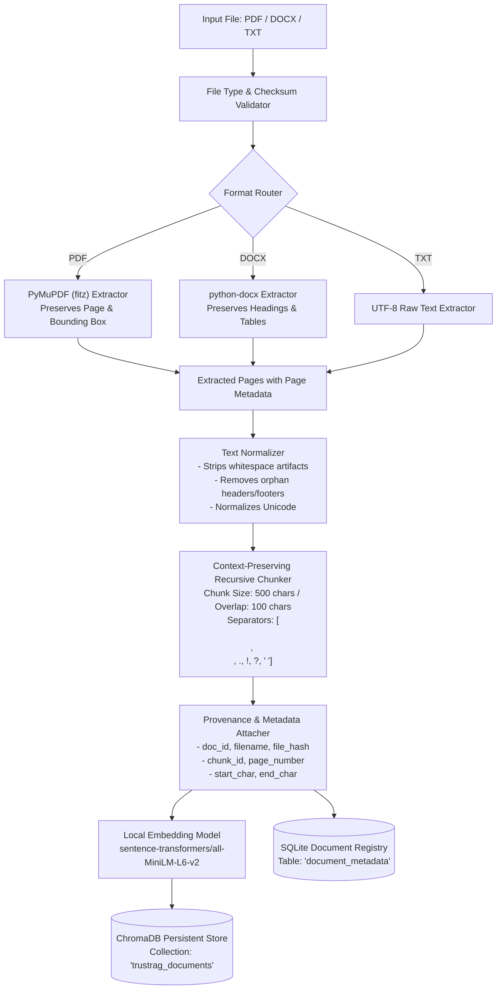

# Ingestion Pipeline Architecture & Design

## 1. Objectives

The Document Ingestion Pipeline converts unstructured documents into structured, search-optimized vector embeddings while strictly preserving **document provenance** (document identity, exact page number, section heading, character offsets). 

In TrustRAG, provenance is not optional: every generated claim must map back to an exact verifiable location in a source document.

---

## 2. Ingestion Pipeline Architecture



---

## 3. Detailed Processing Stages

### 3.1 Document Ingestion & Validation
- **Supported Formats**: `.pdf`, `.docx`, `.txt`.
- **Validation**:
  - File size bounds (default maximum: 25 MB per document).
  - SHA-256 hash generation for deduplication and provenance integrity.
  - MIME-type inspection to prevent malicious file extension spoofing.

### 3.2 Format-Specific Extractors
1. **PDF Extraction (`PyMuPDF / fitz`)**:
   - Iterates through individual pages.
   - Preserves exact page indexing (1-based index).
   - Extracts blocks and structural headings where available.
   - Filters out running headers and footers using geometric vertical coordinate thresholds (e.g., top 5% and bottom 5% of page height).
2. **DOCX Extraction (`python-docx`)**:
   - Parses document paragraphs and structural styles (`Heading 1`, `Heading 2`, `Normal`).
   - Maintains the active hierarchical section header associated with each paragraph.
   - Extracts tables as structured Markdown strings to retain row-column alignment.
3. **TXT Extraction**:
   - Standard UTF-8 decoding with fallback to `latin-1` on encoding errors.

### 3.3 Text Normalization & Cleaning
- Replaces non-standard whitespace characters (non-breaking spaces, form feeds) with standard spaces.
- Normalizes unicode characters (NFKC normalization).
- Removes hyphens resulting from line-break syllable splits (e.g., `infor-\nmation` $\rightarrow$ `information`).
- Preserves bullet points, numbered lists, and punctuation necessary for semantic sentence boundary detection.

### 3.4 Chunking Strategy
Naïve fixed-token chunking cuts sentences in half, severing semantic context and leading to contradictory or unsupported claim flags during verification.

TrustRAG uses a **Context-Aware Recursive Character Chunking** strategy:
- **Target Chunk Size**: $500$ characters ($\approx 100\text{--}120$ tokens).
- **Chunk Overlap**: $100$ characters ($\approx 20\text{--}25$ tokens).
- **Separators (in priority order)**:
  1. `\n\n` (Paragraph boundaries)
  2. `\n` (Line breaks)
  3. `. ` / `! ` / `? ` (Sentence boundaries)
  4. `; ` / `, ` (Clause boundaries)
  5. ` ` (Word boundaries)

**Rationale**:
- $500$ characters provides sufficient context for a specific policy rule (e.g., leave carry-forward rules, medical leave documentation) without diluting the semantic embedding with unrelated paragraphs.
- An overlap of $100$ characters guarantees that sentences split across chunk boundaries do not lose antecedent context (e.g., pronouns referring to entities defined in the preceding chunk).

### 3.5 Provenance & Metadata Schema
Every chunk stored in the vector database and SQLite registry includes:

```json
{
  "chunk_id": "doc_a3f89b_p003_c0012",
  "doc_id": "doc_a3f89b",
  "filename": "Employee_Handbook_2026.pdf",
  "file_hash": "e3b0c44298fc1c149afbf4c8996fb92427ae41e4649b934ca495991b7852b855",
  "page_number": 3,
  "section_title": "Section 4.2: Annual Leave & Carry Forward",
  "char_start": 1420,
  "char_end": 1915,
  "created_at": "2026-11-11T11:45:00Z"
}
```

---

## 4. Embedding Generation & Vector Indexing

### 4.1 Embedding Model
- **Model**: `sentence-transformers/all-MiniLM-L6-v2`
- **Vector Dimension**: $384$ float32 numbers.
- **Context Length**: 256 WordPiece tokens.
- **Inference Hardware**: Runs locally on CPU via PyTorch / OnnxRuntime.
- **Execution Speed**: $\approx 10\text{--}20$ ms per chunk on modern standard CPUs; zero external API latency, zero cost.

### 4.2 ChromaDB Collection Design
- **Collection Name**: `trustrag_documents`
- **Distance Metric**: Cosine Distance ($1 - \text{cosine\_similarity}$).
- **Storage Location**: Local directory `./data/chromadb/`
- **Persistence**: Atomic updates using Chroma's built-in SQLite/DuckDB persistent storage engine.

---

## 5. Ingestion Error Handling & Edge Cases

| Edge Case | Failure Mode | Mitigation in TrustRAG |
| :--- | :--- | :--- |
| **Scanned / Image-Only PDF** | Extractor yields 0 characters | Check page character count; if $< 20$ chars on non-blank page, mark document with status `NEEDS_OCR` and reject with informative error (preventing empty chunk ingestion). |
| **Password Protected File** | Parser throws decryption exception | Catch cryptographic exceptions; reject file with error `ENCRYPTED_DOCUMENT`. |
| **Duplicate Document Upload** | Re-embedding identical files wastes resources and pollutes retrieval | Compute SHA-256 before parsing; if hash already exists in SQLite registry, abort re-indexing and return existing `doc_id`. |
| **Tables & Lists** | Flat chunker splits table rows across chunks | Markdown-formatted table extraction preserves header rows on each sub-chunk to prevent loss of tabular column context. |

