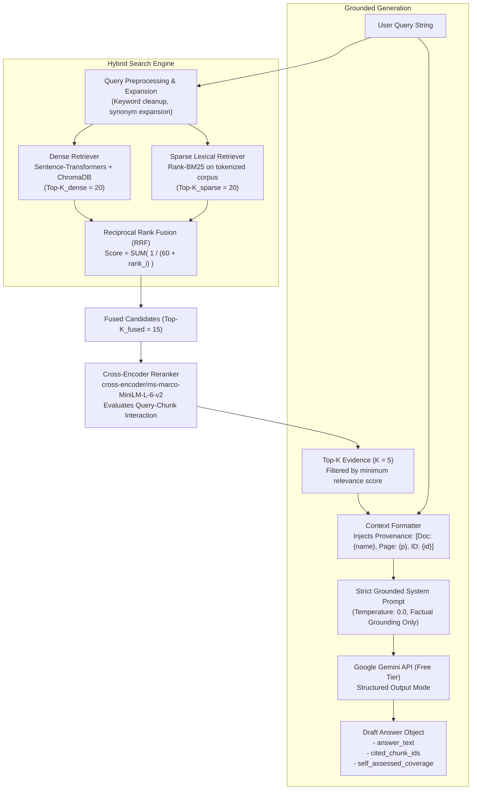

# Retrieval & Grounded Generation Pipeline

## 1. Overview

The Retrieval and Generation Pipeline is responsible for identifying the most relevant, high-fidelity evidence chunks from indexed documents and instructing the Language Model to synthesize an answer bounded strictly by that evidence.

In TrustRAG, generation is not an open-ended conversation; it is a **constrained synthesis with mandatory citation tagging**.

---

## 2. Pipeline Architecture



---

## 3. Hybrid Retrieval Architecture

### 3.1 Rationale for Proposed Hybrid Search
Dense semantic search and sparse lexical search offer complementary characteristics:
- **Dense Vector Search Alone** captures broad conceptual similarity but can struggle with exact numeric limits, alphanumeric policy identifiers (e.g., "HR-POL-04"), and specific policy thresholds (e.g., distinguishing between "15 unused leaves" and "5 unused leaves").
- **Sparse BM25 Alone** ensures exact keyword matching but struggles with semantic variations, synonyms, and natural language paraphrasing (e.g., "vacation carry-forward" vs. "annual leave transfer").
- **Proposed Hybrid Strategy**: Combining BM25, dense retrieval, Reciprocal Rank Fusion (RRF), and Cross-Encoder reranking is a **proposed architectural hypothesis**. It does **not** guarantee high precision or recall by default; its actual performance benefits, rank improvements, and latency overheads must be experimentally measured and evaluated against dense-only and sparse-only baselines in Phase 6 and Phase 9.

### 3.2 Reciprocal Rank Fusion (RRF) (Proposed)
Given a document chunk $d$, dense ranking $r_{\text{dense}}(d)$, and sparse BM25 ranking $r_{\text{sparse}}(d)$:

$$\text{RRF\_Score}(d) = \sum_{m \in \{\text{dense}, \text{sparse}\}} \frac{1}{k + r_m(d)}$$

Where $k$ is a smoothing constant set provisionally to $60$ (standard industry baseline preventing low ranks from dominating). Its optimal value will be evaluated empirically.

### 3.3 Cross-Encoder Reranking (Proposed)
While bi-encoders (dense vector search) compute embeddings independently, a **Cross-Encoder** feeds the query and chunk simultaneously into attention layers to capture full cross-attention interactions:

$$\text{Input} = [\text{CLS}] + \text{Query} + [\text{SEP}] + \text{Chunk Text} + [\text{EOS}]$$

- **Candidate Model**: `cross-encoder/ms-marco-MiniLM-L-6-v2`
- **Output**: Direct scalar relevance score $R_{\text{rerank}} \in [0.0, 1.0]$.
- **Provisional Selection Rule**: Top $K=5$ chunks with $R_{\text{rerank}} \ge \tau_{\text{retrieval}}$ (provisional threshold $\tau_{\text{retrieval}} = 0.35$). The utility and latency trade-off of this step will be validated during Phase 6.

---

## 4. Grounded Context Construction

Retrieved chunks are formatted with explicit provenance tags so the generator and verification engine can trace every token:

```text
=== CONTEXT START ===
[Source 1]
Document: Employee_Handbook_2026.pdf
Page: 3
Section: Section 4.2 Annual Leave
Chunk_ID: doc_a3f89b_p003_c0012
Text: "Employees receive 18 paid leaves annually. Work-from-home requires manager approval. Medical leave requires supporting documentation. Unused leaves can be carried forward up to a maximum of 5 days into the following calendar year. Any remaining unused leave beyond 5 days will lapse automatically."

[Source 2]
Document: Employee_Handbook_2026.pdf
Page: 4
Section: Section 4.3 Sick & Medical Leave
Chunk_ID: doc_a3f89b_p004_c0015
Text: "Sick leave cannot be accumulated or carried forward into the next calendar year."
=== CONTEXT END ===
```

---

## 5. Grounded Prompt Engineering

The generation prompt enforces **zero extrapolation** and **mandatory citation formatting**.

### 5.1 System Prompt Constraints
```text
You are TrustRAG, a factual, evidence-grounded document assistant.

Your task is to answer the user's question using EXCLUSIVELY the provided context.
Follow these mandatory constraints:

1. EVIDENCE BOUNDARY: Rely ONLY on the facts explicitly mentioned in the context. Do not use external knowledge or make assumptions.
2. CITATION REQUIREMENT: For every assertion or claim in your response, append the corresponding source reference tag: [Source X, Page Y].
3. NEGATIVE CONSTRAINTS & LIMITS: If the user asks about a condition that exceeds or contradicts the policy (e.g., asking for 15 days when only 5 are allowed), explicitly state what the policy allows and clarify that the requested amount is unsupported or not permitted.
4. INSUFFICIENT EVIDENCE: If the context does not contain sufficient information to answer the question, state: "The provided documents do not contain information regarding [topic]." Do not attempt to guess or invent details.
5. OBJECTIVITY: Maintain a neutral, professional, and transparent tone.
```

### 5.2 LLM Configuration
- **Model**: Google Gemini 2.5 Flash / 1.5 Flash (Free Tier via Google AI Studio).
- **Temperature**: `0.0` (eliminates stochastic generation variance).
- **Top_P**: `1.0`.
- **Structured Output**: Response requested as a structured Pydantic schema including draft answer text and cited chunk IDs.

---

## 6. Output Contract

```json
{
  "draft_answer": "According to the policy, employees can carry forward a maximum of 5 unused leaves into the following year [Source 1, Page 3]. Carrying forward 15 unused leaves is not permitted by the policy.",
  "cited_sources": [
    {
      "source_index": 1,
      "chunk_id": "doc_a3f89b_p003_c0012",
      "document": "Employee_Handbook_2026.pdf",
      "page": 3
    }
  ],
  "retrieval_metadata": {
    "dense_top_score": 0.82,
    "reranker_top_score": 0.88,
    "chunks_evaluated": 5
  }
}
```

