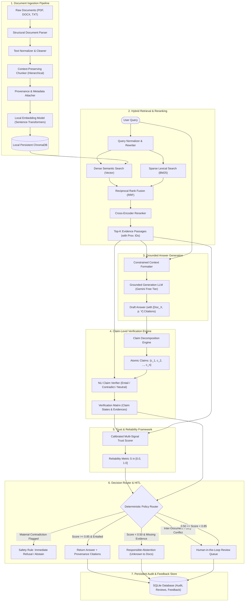

# TrustRAG: System Overview & Architecture Specification

## 1. Executive Summary

**TrustRAG (Intelligent Trust-Aware Retrieval-Augmented Generation System)** is an enterprise-grade document question-answering architecture designed to solve the critical vulnerability of standard RAG systems: **hallucination, ungrounded extrapolation, and blind over-confidence**.

Unlike standard RAG pipelines that simply stuff retrieved passages into a language model and return whatever is generated, TrustRAG introduces an **independent Trust & Reliability Verification Layer**. This layer decomposes answers into verifiable declarative claims, evaluates factual entailment and contradiction against retrieved source evidence, computes a mathematically calibrated **Reliability Score**, and routes responses through an automated **Decision Engine** that can answer, retry, clarify, abstain, or escalate to a **Human-in-the-Loop (HITL)** queue.

---

## 2. High-Level System Architecture

The following diagram represents the end-to-end dataflow and component boundaries of TrustRAG:

---

## 3. Core Architectural Principles

1. **Evidence-Bounded Generation**: The system never treats LLM parametric memory as a primary knowledge source for enterprise documents. The retrieved context constitutes the sole authorized knowledge base.
2. **Explicit Claim Decomposition**: Generated responses are not evaluated holistically as a single block of text. They are broken down into atomic, unambiguous declarative claims before verification.
3. **Strict Contradiction Safety Override & Conflict Escalation**: If any atomic claim in a generated answer directly contradicts the source documents, the overall reliability score cannot rescue the answer; a safety circuit breaker forces an immediate refusal or policy limitation explanation. If two retrieved source documents contradict each other (inter-document conflict), the system does not guess or treat the answer as false; it escalates the conflict to authorized human review.
4. **Distinction Between Similarity, Support, and Truth**: Vector cosine similarity measures geometric proximity in an embedding space, not logical entailment. The TrustRAG Reliability Score is an empirical *evidence-support index*, not a Bayesian probability of correctness or metaphysical truth.
5. **Experimental Validation of Proposed Techniques**: Architectural choices such as hybrid retrieval (BM25 + Dense + RRF) and cross-encoder reranking are proposed techniques whose concrete utility and latency profile must be empirically validated against baselines on labeled benchmark datasets.
6. **No Blind Automation (Human-in-the-Loop)**: For ambiguous, borderline, or conflicting policy queries, the system generates an audit record and flags the query for authorized human review rather than guessing.
7. **Zero-Budget & Local-First Philosophy**:
   - Embeddings: Executed locally via CPU-optimized Sentence Transformers (`all-MiniLM-L6-v2` or `bge-small-en-v1.5`).
   - Vector Store: Local persistent ChromaDB (no cloud cluster required).
   - Metadata & Audit: Local SQLite relational storage.
   - LLM: Google AI Studio Gemini Flash free tier with rate-limit guarding and exponential backoff.
   - Runtimes: Targeting Python 3.12 for seamless ecosystem wheel compatibility.

---

## 4. Component Responsibility Matrix

| Subsystem | Primary Responsibility | Inputs | Outputs | Primary Technology |
| :--- | :--- | :--- | :--- | :--- |
| **Ingestion Pipeline** | Parse, chunk, and index source documents with structural provenance. | PDF, DOCX, TXT files | Vector embeddings + ChromaDB index | PyMuPDF, python-docx, Sentence Transformers, ChromaDB |
| **Retrieval Engine** | Find and rank passages containing direct evidence for the query. | User query string | Top-K ranked evidence passages | BM25, ChromaDB Vector Search, Cross-Encoder Reranker |
| **Generation Engine** | Synthesize a grounded draft response strictly citing source chunks. | User query + Top-K evidence | Draft answer with citation tags | LangChain, Google Gemini API (Free Tier) |
| **Verification Engine** | Decompose draft answer into claims and check entailment against evidence. | Draft answer + Top-K evidence | Claim statuses: `Entailed`, `Contradicted`, `Neutral` | Structured LLM prompt / Local NLI |
| **Trust Engine** | Compute a calibrated multi-signal reliability score. | Claim matrix + retrieval metrics | Reliability Score ($S \in [0.0, 1.0]$) + explanation | Custom Mathematical Trust Engine |
| **Decision Engine** | Direct the response to User, Retry, Abstain, or HITL Review. | Reliability Score + Safety flags | Final Response Action | LangGraph State Machine |
| **Audit & Review Store** | Record queries, answers, evidence, and human corrections. | Final system transaction | Persistent query/audit logs | SQLite + SQLAlchemy |

---

## 5. Technology Stack Decisions

### 5.1 Python Runtime
- **Target**: Python `3.12.x`.
- **Rationale**: Python 3.12 has established pre-compiled wheels for all critical machine learning, C++ bindings, and vector database libraries (PyTorch, OnnxRuntime, ChromaDB, tokenizers). While Python 3.14 is installed on the host, Phase 2 will construct a dedicated Python 3.12 virtual environment (`.venv`) to ensure deterministic builds on Windows without native C++ compiler build failures.

### 5.2 Local Embeddings & Vector Storage
- **Embeddings**: `sentence-transformers/all-MiniLM-L6-v2` (384 dimensions) or `BAAI/bge-small-en-v1.5`.
  - Zero API cost, operates completely offline, minimal CPU memory footprint (~120 MB).
- **Vector DB**: `ChromaDB` (Persistent DuckDB/SQLite local storage).
  - Embeds directly into the Python process; stores chunk text and rich metadata schemas locally on disk in `./data/chromadb/`.

### 5.3 Workflow Orchestration: LangGraph
- LangGraph provides stateful, cyclic workflow execution. Unlike linear chains, LangGraph allows:
  - Conditional branching based on verification scores.
  - Looping back for retrieval refinement when evidence coverage is low.
  - Suspending graph execution for human review and resuming state upon reviewer feedback.

---

## 6. Document Roadmap

The remaining documents in this directory define the comprehensive architecture of each sub-system:
1. `ingestion-pipeline.md`: Parsing, text cleaning, chunking strategies, and metadata schema.
2. `retrieval-generation.md`: Hybrid search, reranking, context assembly, and grounded prompt engineering.
3. `verification-engine.md`: Claim decomposition, NLI tripartite classification, and evidence attribution.
4. `trust-scoring.md`: Mathematical formulation of multi-signal reliability, normalization, and safety rules.
5. `decision-engine.md`: State machine flow, routing thresholds, fallback policies, and human-in-the-loop workflows.
6. `data-models.md`: Strict JSON schemas and data contracts across all pipeline stages.
7. `failure-handling.md`: Fallback behaviors, rate-limit protections, out-of-context handling, and error states.
8. `evaluation-framework.md`: Offline and continuous benchmarking methodology across 5 query topologies and abstention metrics.
8. `evaluation-framework.md`: Offline and continuous benchmarking methodology across 5 query topologies.

