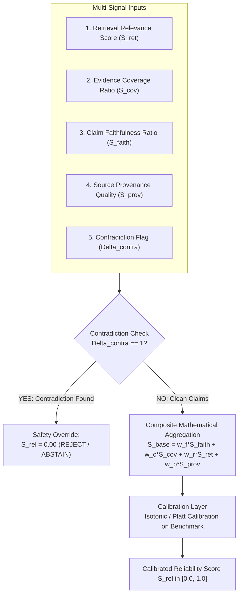

# Trust & Reliability Scoring Framework

## 1. Foundational Principles & Epistemic Stance

### 1.1 Distinction Between Reliability Score and Probability of Correctness
In machine learning and RAG systems, practitioners often mistake geometric vector similarities or composite heuristics for a *true Bayesian posterior probability of correctness* ($P(\text{Correct} \mid Q, C)$). 

**TrustRAG explicitly rejects this fallacy:**
1. **Geometric Distance $\neq$ Logical Truth**: A cosine similarity of $0.85$ between a query and a chunk signifies topical proximity, not that the factual proposition is logically true or comprehensive.
2. **Softmax Output $\neq$ Calibrated Confidence**: Modern neural networks are frequently overconfident on out-of-distribution inputs.
3. **Definition of TrustRAG Reliability Score ($S_{\text{rel}}$)**:
   The TrustRAG Reliability Score is a **transparent, bounded $[0.0, 1.0]$, multi-signal empirical evidence-support index**, NOT a probability of correctness. It measures the degree to which a generated response is structurally grounded in, entailed by, and consistent with the retrieved document evidence. It reflects *evidentiary and contextual backing within the provided corpus*, not absolute metaphysical truth or real-world factual correctness.

### 1.2 The Absolute Contradiction Circuit Breaker
Under no circumstances may strong retrieval relevance compensate for a material contradiction in generated claims.

However, an essential architectural distinction is made:
- **Claim-Level Material Contradiction ($\Delta_{\text{contra}} = 1$)**: The generated answer asserts a claim that directly refutes or violates the explicit constraints of the retrieved evidence (e.g., asserting 15 leaves can be carried forward when the policy explicitly limits it to 5). This triggers an immediate safety circuit breaker:
  $$\Delta_{\text{contra}} = 1 \implies S_{\text{rel}} \leftarrow 0.0 \quad (\text{Immediate Safety Circuit Breaker Active})$$
- **Source-Level Inter-Document Conflict**: Two retrieved source passages in the corpus contradict each other (e.g., an outdated 2023 policy stating 10 days vs. an updated 2026 policy stating 5 days). This is **not** treated as an automatic failure of the generated answer, but as an *institutional knowledge conflict*. The system must not guess which policy takes precedence; instead, it flags an `INTER_DOCUMENT_CONFLICT` and escalates the query directly to the Human-in-the-Loop review queue.

---

## 2. Multi-Signal Components

The reliability framework synthesizes five orthogonal signals:

---

## 3. Mathematical Formulation

Let $Q$ be the user query, $\mathcal{E} = \{e_1, e_2, \dots, e_k\}$ be the retrieved Top-$K$ evidence chunks, and $\mathcal{C} = \{c_1, c_2, \dots, c_n\}$ be the atomic claims extracted from the draft answer $A$.

### 3.1 Signal 1: Retrieval Relevance Score ($S_{\text{ret}}$)
Computed from the cross-encoder reranker score $R(Q, e_j) \in [0, 1]$ of the chunks actually cited by the generator:

$$S_{\text{ret}} = \frac{1}{|\mathcal{E}_{\text{cited}}|} \sum_{e \in \mathcal{E}_{\text{cited}}} R(Q, e)$$

If no chunks are cited or retrieved, $S_{\text{ret}} = 0.0$.

### 3.2 Signal 2: Evidence Coverage Ratio ($S_{\text{cov}}$)
Measures the proportion of essential query facets addressed by the retrieved evidence. If a query asks *"What are the annual leaves and how do I request medical leave?"* but the retrieved chunks only mention annual leaves, coverage is $0.5$.

$$S_{\text{cov}} = \frac{|\mathcal{F}_{\text{addressed}}|}{|\mathcal{F}_{\text{total}}|}$$

Where $\mathcal{F}$ represents the query facets extracted during query decomposition.

### 3.3 Signal 3: Claim-Level Faithfulness Ratio ($S_{\text{faith}}$)
The ratio of strictly entailed atomic claims to total generated atomic claims:

$$S_{\text{faith}} = \frac{|\{c \in \mathcal{C} \mid \text{Status}(c) = \text{ENTAILMENT}\}|}{|\mathcal{C}|}$$

If $|\mathcal{C}| = 0$ (e.g. empty response or immediate refusal), $S_{\text{faith}}$ defaults to $1.0$ if abstention was warranted, or $0.0$ if answer was requested.

### 3.4 Signal 4: Source Provenance Quality ($S_{\text{prov}}$)
Quantifies the structural reliability of the source document itself:

$$S_{\text{prov}} = \frac{1}{|\mathcal{E}_{\text{cited}}|} \sum_{e \in \mathcal{E}_{\text{cited}}} \left( \lambda_{\text{page}} \cdot \mathbb{I}(\text{has\_page}) + \lambda_{\text{sec}} \cdot \mathbb{I}(\text{has\_section}) + \lambda_{\text{hash}} \cdot \mathbb{I}(\text{valid\_hash}) \right)$$

Default weights: $\lambda_{\text{page}} = 0.4$, $\lambda_{\text{sec}} = 0.3$, $\lambda_{\text{hash}} = 0.3$. Chunks with complete page, section, and cryptographic checksum scores earn $1.0$.

### 3.5 Signal 5: Contradiction Indicator ($\Delta_{\text{contra}}$)
Binary indicator for any contradictory claim:

$$\Delta_{\text{contra}} = \begin{cases} 1 & \text{if } \exists \, c \in \mathcal{C} \text{ such that } \text{Status}(c) = \text{CONTRADICTION} \\ 0 & \text{otherwise} \end{cases}$$

---

## 4. Synthesis & Score Aggregation

### 4.1 Base Reliability Score ($S_{\text{base}}$)
When $\Delta_{\text{contra}} = 0$, the base score is computed as a weighted linear combination:

$$S_{\text{base}} = w_{\text{faith}} S_{\text{faith}} + w_{\text{cov}} S_{\text{cov}} + w_{\text{ret}} S_{\text{ret}} + w_{\text{prov}} S_{\text{prov}}$$

Subject to:
$$\sum w_i = 1.0, \quad w_i \ge 0$$

### 4.2 Initial Parameter Weighting (Provisional Prior to Calibration)
> [!IMPORTANT]
> The weights assigned below ($w_{\text{faith}}=0.50$, $w_{\text{cov}}=0.25$, $w_{\text{ret}}=0.15$, $w_{\text{prov}}=0.10$) are **strictly provisional baseline engineering priors**. They must not be treated as immutable truths. These parameters must be empirically validated, tuned, and calibrated using labeled benchmark datasets in Phase 9.

- **$w_{\text{faith}} = 0.50$ (Provisional)**: Faithfulness is prioritized as the primary weight because unsupported claims represent hallucinations.
- **$w_{\text{cov}} = 0.25$ (Provisional)**: High faithfulness on an incomplete answer still leaves the user misinformed.
- **$w_{\text{ret}} = 0.15$ (Provisional)**: Requisite relevance of retrieved passages.
- **$w_{\text{prov}} = 0.10$ (Provisional)**: Metadata and provenance completeness.

### 4.3 Total Score with Safety Override
$$S_{\text{rel}} = (1 - \Delta_{\text{contra}}) \cdot S_{\text{base}}$$

If a claim-level material contradiction exists ($\Delta_{\text{contra}} = 1$), $S_{\text{rel}} \equiv 0.00$.

---

## 5. Signal Limitations & Failure Modes

Each constituent signal has intrinsic failure modes that the composite framework and human oversight are designed to mitigate:

| Signal | Core Metric | Inherent Limitations & Edge-Case Failure Modes |
| :--- | :--- | :--- |
| **Retrieval Relevance ($S_{\text{ret}}$)** | Cross-encoder relevance $R(Q, e)$ | **Geometric Topicality $\neq$ Answerability**: A passage may be topically identical to the query (high score) yet fail to contain the specific policy answer. It can also be vulnerable to keyword spoofing or semantic drift. |
| **Evidence Coverage ($S_{\text{cov}}$)** | Ratio of addressed query facets | **Decomposition Sensitivity**: Relies on accurate query facet extraction. Complex multi-part queries with implicit premises may have unextracted facets, artificially inflating or deflating the coverage ratio. |
| **Claim Faithfulness ($S_{\text{faith}}$)** | Ratio of strictly entailed claims | **NLI Model Nuance & Granularity**: Weak NLI models may misclassify subtle linguistic hedges, negative phrasing, or domain-specific legal jargon. Decomposition errors (e.g. over-segmentation) can fragment context. |
| **Source Provenance ($S_{\text{prov}}$)** | Metadata completeness index | **Structure $\neq$ Validity**: A document can possess flawless metadata (page numbers, section headings, cryptographic SHA-256 hash) while its internal policy text is outdated, superseded, or poorly drafted. |
| **Contradiction Flag ($\Delta_{\text{contra}}$)** | Binary claim contradiction | **False Contradictions & Negation Blindness**: Models can misinterpret polite negations or rhetorical contrasts as factual contradictions. Conversely, subtle numeric contradictions (e.g., "$5$ days" vs "$6$ days") might be overlooked without explicit numeric constraint checking. |

---

## 6. Threshold Selection & Decision Boundaries (Provisional)

Based on empirical validation on benchmark evaluation sets, responses are partitioned into three primary operational bands:

| Score Interval | Operational Category | Decision Engine Action |
| :--- | :--- | :--- |
| **$S_{\text{rel}} \ge 0.85$** | **High Trust / Verified** | Return answer directly to user with source citations. |
| **$0.50 \le S_{\text{rel}} < 0.85$** | **Borderline / Uncertain** | If coverage is low, attempt 1 retrieval retry. If still uncertain, route to **Human-in-the-Loop Queue**. |
| **$0.00 \le S_{\text{rel}} < 0.50$** | **Low Trust / Unsupported** | **Abstain**: Return transparent refusal explaining that evidence is absent or contradictory. |

---

## 7. Calibration Methodology on Labeled Benchmark Data

To ensure that the provisional score $S_{\text{rel}}$ maps reliably and monotonically to empirical human-verified correctness, calibration must be systematically validated using labeled benchmark data:

1. **Labeled Benchmark Holdout Split**: 
   Maintain an offline evaluation benchmark of 250 diverse question-context-answer triples manually labeled by domain auditors ($y \in \{0, 1\}$ for factual groundedness, along with labeled claim-level entailment tags).
2. **Empirical Validation vs. Heuristics**:
   The provisional linear weights ($w_i$) must be tested against this labeled holdout set to confirm that higher reliability scores strictly correlate with lower empirical hallucination rates. If queries with $S_{\text{rel}} \ge 0.85$ exhibit hallucinations $> 2\%$, the thresholds and component weights must be adjusted.
3. **Calibration Curves (Reliability Diagrams)**:
   Plot empirical accuracy against binned predicted score intervals $[0.0\text{--}0.1], [0.1\text{--}0.2], \dots, [0.9\text{--}1.0]$.
4. **Isotonic Regression / Platt Scaling**:
   Fit a monotonic mapping function $f: S_{\text{base}} \mapsto [0, 1]$ minimizing Expected Calibration Error (ECE):
   $$\text{ECE} = \sum_{m=1}^{M} \frac{|B_m|}{N} \left| \text{acc}(B_m) - \text{conf}(B_m) \right|$$
5. **Periodic Re-Calibration**: Re-validate and re-calibrate weights $w_i$ whenever the underlying embedding model, chunking parameters, reranker, or generation prompt template is modified.

