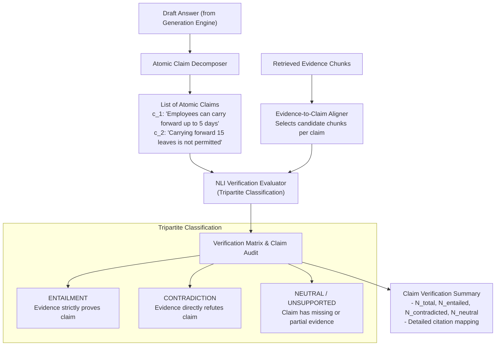

# Answer Verification Engine Architecture

## 1. Problem Statement

Standard RAG systems treat LLM answer generation as the final step. However, LLMs routinely:
1. Hallucinate plausible facts not present in the retrieved chunks.
2. Extrapolate conditions (e.g., claiming exceptions apply when none are mentioned).
3. Gloss over contradictions (e.g., answering "Yes" to an unpermitted request).

The **TrustRAG Verification Engine** operates as an independent audit layer. It intercepts the draft answer *before* it reaches the user, extracts atomic claims, and validates each claim against the retrieved evidence using Natural Language Inference (NLI).

---

## 2. Verification Architecture



---

## 3. Claim Decomposition Engine

Answers often contain composite sentences with multiple assertions. Holistic evaluation fails because a sentence may be 80% true and 20% hallucinated.

### 3.1 Decomposition Rules
1. **Atomicity**: Each claim must represent a single, self-contained declarative fact.
2. **Decontextualization**: Pronouns and relative clauses must be resolved into explicit entities (e.g., "They receive 18 days" $\rightarrow$ "Employees receive 18 paid leaves annually").
3. **No Inference Injection**: Decomposition must not extrapolate beyond the draft text.

### 3.2 Decomposition Example
- **Draft Sentence**: *"Employees receive 18 paid leaves and can carry forward up to 5 unused days with manager approval."*
- **Decomposed Atomic Claims**:
  - $c_1$: *"Employees receive 18 paid leaves annually."*
  - $c_2$: *"Employees can carry forward up to 5 unused leaves."*
  - $c_3$: *"Carrying forward unused leave requires manager approval."*

---

## 4. Tripartite Verification Taxonomy & Contradiction Types

### 4.1 Claim-Level Tripartite Outcomes
For each claim $c_i$ and retrieved evidence passage $E$:

| Verification Outcome | Formal Definition | System Interpretation | Example |
| :--- | :--- | :--- | :--- |
| **`ENTAILMENT`** | $\text{Premise}(E) \implies c_i$ | The claim is directly and strictly substantiated by the text. | Claim: *"Maximum 5 unused leaves can be carried forward."*<br/>Evidence: *"Unused leaves can be carried forward up to a maximum of 5 days."* |
| **`CONTRADICTION`** | $\text{Premise}(E) \implies \neg c_i$ | The claim directly asserts a statement refuted by the text, or violates an explicit limitation. | Claim: *"Employees can carry forward 15 unused leaves."*<br/>Evidence: *"Unused leaves can be carried forward up to a maximum of 5 days."* |
| **`NEUTRAL / UNSUPPORTED`** | $\text{Premise}(E) \not\implies c_i \land \text{Premise}(E) \not\implies \neg c_i$ | The text neither substantiates nor explicitly refutes the claim; fact is absent or extrapolated. | Claim: *"Carrying forward leave requires VP-level sign-off."*<br/>Evidence does not mention sign-off requirements. |

> [!IMPORTANT]
> The system **must never present unsupported or neutral claims as verified facts**. If a claim is unsupported, it must either be excised from the response or clearly labeled as unverified in the UI.

### 4.2 Distinguishing Claim Contradictions from Inter-Document Policy Conflicts
A critical architectural principle in TrustRAG is separating **claim falsehood** from **source corpus discord**:

1. **Material Claim Contradiction**:
   - Occurs when the generator fabricates a statement that directly conflicts with the retrieved evidence (e.g., claiming 15 carry-forward leaves when the text states 5).
   - **System Behavior**: Triggers the safety circuit breaker ($\Delta_{\text{contra}} = 1, S_{\text{rel}} \equiv 0.00$) and forces an immediate refusal or policy limitation explanation.
2. **Inter-Document Policy Conflict**:
   - Occurs when two or more retrieved source passages present contradictory rules (e.g., a regional handbook stating 18 annual leaves while an executive addendum states 22 annual leaves, or an older document conflicting with a newer revision).
   - **Crucial Rule**: The system **must not automatically treat every conflicting source passage as proof that the generated answer is false**. It cannot assume that the LLM hallucinated, nor may it silently pick one document over the other.
   - **System Behavior**: The verification engine flags an `INTER_DOCUMENT_POLICY_CONFLICT` event and routes the query directly to the **Human-in-the-Loop (HITL) Review Queue**, presenting both passages to the human auditor for authoritative resolution.

---

## 5. Verification Execution Strategy

TrustRAG supports two verification pathways:

### 5.1 Primary Pathway: Structured LLM NLI Evaluation
- Uses Google Gemini Flash with strict temperature $0.0$ and structured JSON output.
- The prompt presents the evidence passages as immutable premises and the extracted claim as the hypothesis.
- The model outputs the classification, the verbatim quotation from the evidence, and an explanation.

### 5.2 Offline / Fallback Pathway: Local NLI Cross-Encoder
- When offline or when API rate limits are reached, claim verification falls back to a locally hosted NLI model (e.g., `cross-encoder/nli-deberta-v3-small` or `roberta-large-snli_mnli_fever_anli_R1_R2_R3-nli`).
- Computes softmax probabilities over `[entailment, neutral, contradiction]`.
- Decision rule:
  $$\text{Outcome}(c_i) = \arg\max_{k} P(k \mid E, c_i)$$

---

## 6. Verification Matrix Schema

The output of the Verification Engine is a structured **Verification Matrix**:

```json
{
  "total_claims": 2,
  "entailed_claims_count": 2,
  "contradicted_claims_count": 0,
  "unsupported_claims_count": 0,
  "claims": [
    {
      "claim_id": "claim_001",
      "text": "Employees can carry forward a maximum of 5 unused leaves into the following year.",
      "status": "ENTAILMENT",
      "confidence": 0.98,
      "supporting_chunk_id": "doc_a3f89b_p003_c0012",
      "verbatim_quote": "Unused leaves can be carried forward up to a maximum of 5 days into the following calendar year."
    },
    {
      "claim_id": "claim_002",
      "text": "Carrying forward 15 unused leaves is not permitted.",
      "status": "ENTAILMENT",
      "confidence": 0.95,
      "supporting_chunk_id": "doc_a3f89b_p003_c0012",
      "verbatim_quote": "Any remaining unused leave beyond 5 days will lapse automatically."
    }
  ],
  "safety_flag": false
}
```

