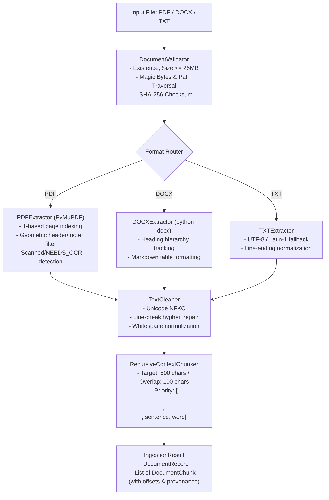

# Phase 3 Documentation: Document Ingestion Pipeline

## 1. Overview

**Phase 3** implements the standalone **Document Ingestion Pipeline** for TrustRAG. The pipeline ingests enterprise documents (`.pdf`, `.docx`, `.txt`), performs pre-ingestion security validation, extracts structural content, normalizes text while preserving factual integrity, chunks documents using a context-preserving recursive strategy ($500$ characters, $100$ characters overlap), and attaches granular document and chunk-level provenance metadata.

---

## 2. Ingestion Architecture & Data Flow



---

## 3. Supported Formats & Extraction Process

| Format | Extraction Engine | Provenance Granularity | Special Extraction Behaviors |
| :--- | :--- | :--- | :--- |
| **PDF** (`.pdf`) | `PyMuPDF` (`pymupdf`) | Exact 1-based `page_number`, `char_start`, `char_end` | Filters running headers/footers in top/bottom 5% margin. Detects scanned/image-only PDFs ($< 20$ printable chars) and raises `NEEDS_OCR`. Handles encrypted files (`ENCRYPTED_DOCUMENT`). |
| **DOCX** (`.docx`) | `python-docx` (`docx`) | Hierarchical `section_title`, `char_start`, `char_end` | Flowable document (unpaginated; `page_number = None`). Converts Word tables into clean Markdown tables (`\| Col \| Col \|`) to preserve tabular structure and cell alignments. |
| **TXT** (`.txt`) | Native Python streaming reader | Document-level `char_start`, `char_end` | Unpaginated (`page_number = None`). Multi-encoding decode fallback: `utf-8` $\rightarrow$ `utf-8-sig` $\rightarrow$ `latin-1` $\rightarrow$ `cp1252`. Normalizes `\r\n` to `\n`. |

---

## 4. Text Cleaning & Normalization

The `TextCleaner` component enforces factual preservation:
1. **Unicode NFKC Normalization**: Standardizes full-width characters, accents, and typographic ligatures.
2. **Line-Break Syllable Split Repair**: Identifies hyphens split across line endings (e.g., `infor-\nmation` $\rightarrow$ `information`) while preserving legitimate compound words like `work-from-home`.
3. **Whitespace Sanitation**: Replaces non-breaking spaces (`\u00a0`), form feeds (`\f`), and zero-width spaces (`\u200b`).
4. **Paragraph Preservation**: Collapses excessive blank lines to standard `\n\n` paragraph boundaries.
5. **Zero Factual Loss**: Numbers, dates, alphanumeric policy codes (`HR-POL-04`), and semantic punctuation are strictly preserved.

---

## 5. Chunking Strategy & Provenance

Adheres strictly to `docs/architecture/ingestion-pipeline.md`:
- **Target Chunk Size**: $500$ characters ($\approx 100\text{--}120$ tokens).
- **Chunk Overlap**: $100$ characters ($\approx 20\text{--}25$ tokens).
- **Separator Hierarchy**: `\n\n` (Paragraphs) $\rightarrow$ `\n` (Lines) $\rightarrow$ `. `, `! `, `? ` (Sentences) $\rightarrow$ `; `, `, ` (Clauses) $\rightarrow$ ` ` (Words).
- **Chunk ID Naming Convention**:
  - Paginated (PDF): `{doc_id}_p{page:03d}_c{idx:04d}` (e.g. `doc_a3f89b12_p003_c0012`)
  - Unpaginated (DOCX/TXT): `{doc_id}_c{idx:04d}` (e.g. `doc_a3f89b12_c0004`)
- **Metadata Preserved per Chunk**:
  - `chunk_id`, `doc_id`, `filename`, `file_hash` (SHA-256)
  - `page_number` (1-based or `None`)
  - `section_title` (e.g., `"### Section 4: Annual Leave"`)
  - `char_start` and `char_end` offsets within page/section
  - `text` (cleaned chunk content)

---

## 6. Error Handling & Structured Status Codes

| Error Condition | Exception Class | Error Code | Mitigation / Behavior |
| :--- | :--- | :--- | :--- |
| **Scanned / Image-Only PDF** | `NeedsOCRError` | `NEEDS_OCR` | Detects when total page text $< 20$ chars on non-blank pages. Rejects with actionable message requesting OCR. |
| **Password Protected / Encrypted PDF** | `EncryptedDocumentError` | `ENCRYPTED_DOCUMENT` | Detects encryption flags / password prompts; cleanly fails without hanging. |
| **Corrupted Binary File** | `CorruptedFileError` | `CORRUPTED_DOCUMENT` | Catches malformed ZIP / PDF structures and raises structured error. |
| **File Extension Spoofing** | `UnsupportedFileTypeError` | `UNSUPPORTED_FILE_TYPE` | Validates magic bytes (`%PDF`, `PK\x03\x04`) rather than relying on extension alone. |
| **Oversized Document** | `FileSizeLimitExceededError` | `FILE_SIZE_EXCEEDED` | Enforces 25 MB limit before loading file into memory. |
| **Empty File** | `EmptyFileError` | `EMPTY_FILE` | Checks for 0-byte files before parsing. |
| **Path Traversal Filename** | `FileValidationError` | `ILLEGAL_FILENAME_CHARS` | Strips directory traversal sequences (`../../`) and null bytes. |

---

## 7. Test Coverage

Comprehensive unit test suite implemented in [`backend/tests/test_ingestion.py`](file:///c:/Users/srinidhi.abushi/Desktop/RAG/backend/tests/test_ingestion.py) containing **24 automated tests**:
- **Validator**: Missing file, empty file, unsupported extension, path traversal sanitization, 25MB size limit, magic bytes spoofing.
- **Cleaner**: Unicode normalization, syllable hyphen repair, compound hyphen preservation.
- **PDF Extractor**: Single-page, multi-page, scanned detection (`NEEDS_OCR`), password encryption (`ENCRYPTED_DOCUMENT`), corrupted binary.
- **DOCX Extractor**: Headings hierarchy, body paragraphs, Markdown table formatting, empty document, corrupted archive.
- **TXT Extractor**: Multi-paragraph UTF-8, Latin-1 fallback, whitespace-only rejection.
- **Chunker**: 500-char limits, 100-char overlap, provenance metadata preservation, unpaginated DOCX naming, short text single-chunk handling.
- **End-to-End Ingestion Service**: Complete ingestion runs for PDF, DOCX, and TXT files asserting `IngestionResult` schema contracts.

Execution command:
```powershell
python -m pytest backend/tests -v
```
Result: **24 passed in 0.69s**.

---

## 8. Known Limitations & Scope Boundaries

1. **No OCR Processing**: Scanned image PDFs are detected and flagged as `NEEDS_OCR`, but optical character recognition is intentionally out of scope for Phase 3 (zero-budget local CPU baseline).
2. **Unpaginated DOCX/TXT**: Page numbers are not invented for flowable Word documents or plain text files; provenance uses section headings, chunk indices, and character offsets.
3. **No Embeddings or Vector DB**: Chunks are generated as structured Pydantic models in memory; vector embedding and ChromaDB indexing are implemented in Phase 4.

---

## 9. Manual Setup Instructions

Activate the project virtual environment and verify Phase 3 dependencies:
```powershell
.\.venv\Scripts\Activate.ps1
python -m pytest backend/tests -v
python scripts/verify_env.py
```

